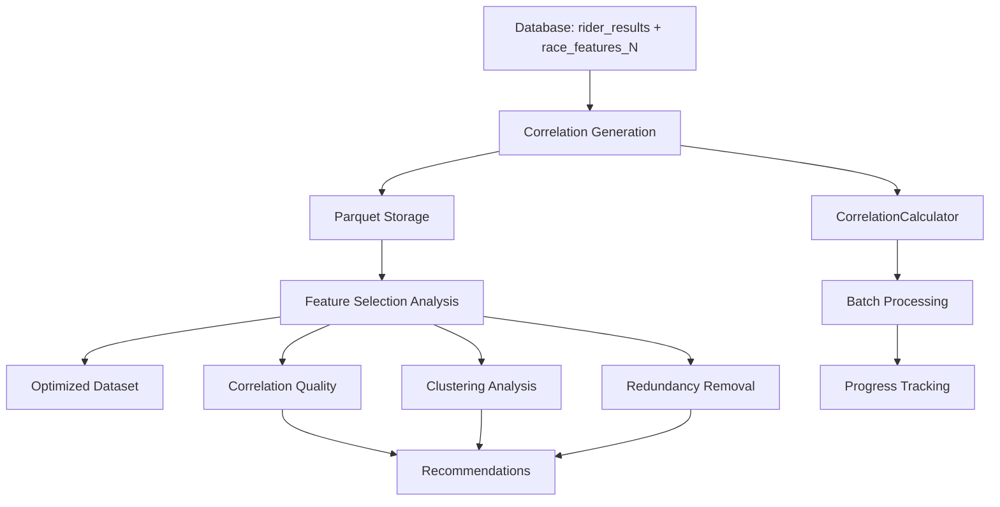

# Rider Embeddings Pipeline

A comprehensive system for generating rider performance characterizations based on race feature correlations. This pipeline transforms raw race results into optimized feature sets that can classify riders into performance-based types.

## 🏗️ Architecture Overview



## 📊 Data Flow

### Input Data
- **`rider_results`**: Historical rider performance data with point-in-time features
- **`race_features_N`**: Race characteristics computed for different percentiles (N = 30, 40, 50, 60, 70, 80, 90, 100)

### Processing Stages
1. **Correlation Generation**: Calculate Spearman correlations between rider points and race features
2. **Storage Optimization**: Efficient parquet-based storage with partitioning
3. **Feature Selection**: Multi-criteria analysis to select optimal percentiles and features
4. **Dataset Export**: Final optimized correlation dataset for modeling

### Output Data
- **Correlation Data**: Rider-feature correlation matrices stored in parquet format
- **Analysis Results**: JSON files with feature selection recommendations and explanations
- **Optimized Dataset**: Final feature set ready for machine learning

## 🧩 Component Architecture

### Core Modules

#### 1. Performance Feature Link (`performance_feature_link/`)
**Purpose**: Calculate relationships between rider performance and race characteristics

```python
# Base interface for all correlation methods
class PerformanceFeatureLinkBase(ABC):
    def calculate_feature_relationships(rider_result_id, lookback_date, feature_tables) -> Dict
```

**Key Components**:
- **`base.py`**: Abstract interface ensuring consistent I/O across methods
- **`correlation_method/`**: Spearman correlation implementation with edge case handling
- **Future extensibility**: Framework supports additional methods (regression, mutual information, etc.)

**Information Flow**:
```
rider_result_id + lookback_date → rider history → join with race_features_N → correlations
```

**Data Transformations**:
- Point-in-time history aggregation (no future leakage)
- Feature variance filtering (eliminates constant features)
- Missing data imputation and handling
- Statistical significance testing

#### 2. Data Generation (`data_generation/`)
**Purpose**: Scalable generation and storage of correlation data

```python
# Main generation orchestrator
class CorrelationDataGenerator:
    def generate_all_correlations(feature_tables, resume=True)
    def generate_sample(sample_size, output_name)
```

**Key Components**:
- **`correlation_generator.py`**: Batch processing with checkpointing and error recovery
- **`parquet_storage.py`**: Storage optimization, validation, and organization tools
- **`data_loader.py`**: Efficient loading interface for downstream analysis

**Scalability Features**:
- Configurable batch sizes for memory management
- Checkpoint system for resuming interrupted runs
- Progress tracking and detailed logging
- Data validation and quality checks

**Storage Architecture**:
```
Raw Generation → Batch Files → Merged Files → Partitioned Dataset → Analysis Ready
correlations_batch_*.parquet → merged_correlations.parquet → partitioned/ → feature_selection
```

#### 3. Feature Selection (`feature_selection/`)
**Purpose**: Multi-criteria analysis to identify optimal features and percentiles

```python
# Integrated analysis pipeline
class FeatureSelectionPipeline:
    def analyze_all(correlation_results, max_features) -> comprehensive_analysis
```

**Analysis Components**:

##### Correlation Quality Analyzer
- **Signal Strength**: Combination of correlation magnitude and variance
- **Feature Coverage**: Proportion of features with sufficient data
- **Dynamic Range**: Spread of correlation values across riders
- **Discriminative Power**: Ability to distinguish between riders

##### Clustering Quality Analyzer  
- **Silhouette Analysis**: Cluster separation quality measurement
- **Optimal K Detection**: Automated cluster number selection
- **PCA Analysis**: Dimensionality and variance explanation
- **Cluster Characterization**: Feature importance per cluster

##### Redundancy Analyzer
- **Correlation Detection**: Identify highly correlated feature pairs (>threshold)
- **Graph-based Grouping**: Connected components of redundant features
- **Quality-based Selection**: Keep highest quality feature from each group
- **Information Theory**: Mutual information alternative measures

**Decision Logic**:
```python
# Percentile selection combines multiple criteria
percentile_score = weighted_average([
    correlation_quality_score,
    clustering_quality_score,
    feature_coverage_score
])

# Feature selection removes redundancy while preserving information
final_features = remove_redundant_groups(
    rank_by_quality(all_features),
    correlation_threshold=0.75
)
```

### Data Structures

#### Correlation Results Format
```python
{
    'rider_result_id': int,
    'feature_correlations': {
        'race_features_100': {
            'variance_normalized': float,
            'gini_coefficient': float,
            # ... ~40 race features
        },
        'race_features_80': {...},
        # ... other percentiles
    },
    'metadata': {
        'n_races': int,
        'method': 'correlation',
        'calculation_date': datetime,
        'warnings': List[str]
    }
}
```

#### Flat Storage Format (Parquet)
```
rider_result_id | percentile        | feature           | correlation | n_races | calculation_date
123            | race_features_100 | variance_normalized| 0.456      | 15      | 2024-01-01
123            | race_features_100 | gini_coefficient   | -0.234     | 15      | 2024-01-01
```

#### Analysis Results Format
```python
{
    'analysis_metadata': {...},
    'correlation_quality_analysis': {
        'percentile_quality_metrics': {...},
        'percentile_rankings': [...]
    },
    'clustering_analysis': {
        'percentile_analyses': {...},
        'ranked_percentiles': [...],
        'best_percentile': str
    },
    'feature_analysis': {...},
    'redundancy_analysis': {...},
    'recommendations': {
        'percentile_recommendations': {...},
        'feature_recommendations': {...},
        'summary': {
            'recommended_percentile': str,
            'recommended_features': List[str],
            'feature_count': int
        }
    }
}
```

## 🔄 Processing Pipeline

### Phase 1: Correlation Generation
```python
# For each rider result in database
for rider_result_id, competition_date in eligible_results:
    # Get rider's prior race history (point-in-time)
    history = get_rider_history(rider_id, before=competition_date)
    
    # For each race features percentile
    for percentile in ['race_features_30', ..., 'race_features_100']:
        # Join history with race features
        feature_data = join(history, race_features[percentile])
        
        # Calculate correlations
        correlations = spearman_correlation(points, features)
        
        # Store flat format
        store_correlation(rider_result_id, percentile, feature, correlation)
```

### Phase 2: Storage Optimization
```python
# Batch processing with efficiency optimizations
batch_files = process_in_batches(all_riders, batch_size=100)

# Storage optimization
merged_file = merge_batches(batch_files)
partitioned_dataset = partition_by_percentile(merged_file)

# Quality assurance
validation_report = validate_data_integrity(partitioned_dataset)
```

### Phase 3: Feature Selection Analysis
```python
# Multi-criteria analysis
correlation_quality = analyze_correlation_metrics(correlation_data)
clustering_quality = analyze_clustering_separation(correlation_data)
redundancy_analysis = identify_redundant_features(correlation_data)

# Integration and ranking
percentile_rankings = rank_percentiles(correlation_quality, clustering_quality)
feature_rankings = rank_features(quality_metrics, redundancy_analysis)

# Final recommendations
best_percentile = select_optimal_percentile(percentile_rankings)
best_features = remove_redundancy(feature_rankings, threshold=0.75)
```

## 🎯 Key Design Principles

### 1. **Modularity**
- Each correlation method implements the same interface
- Feature selection components are swappable
- Analysis stages can be run independently

### 2. **Scalability** 
- Batch processing prevents memory overload
- Checkpoint system enables resuming large jobs
- Partitioned storage allows efficient querying

### 3. **Data Integrity**
- Point-in-time calculations prevent future leakage
- Comprehensive validation at each stage
- Detailed logging and error tracking

### 4. **Extensibility**
- Abstract base classes enable new methods
- Plugin architecture for custom analyses
- Configurable parameters for different use cases

### 5. **Reproducibility**
- Deterministic algorithms with fixed random seeds
- Complete metadata tracking
- Version-controlled analysis parameters

## 🔍 Mathematical Foundation

### Correlation Calculation
```python
# For each rider-feature pair
def calculate_correlation(rider_points, feature_values):
    # Filter to valid data points
    valid_mask = ~(isnan(rider_points) | isnan(feature_values))
    
    # Require minimum sample size and variance
    if sum(valid_mask) >= min_races and std(feature_values) > threshold:
        correlation, p_value = spearmanr(rider_points, feature_values)
        return correlation if not isnan(correlation) else None
    return None
```

### Quality Metrics
```python
# Signal strength combines correlation magnitude and variance
signal_strength = mean_abs_correlation * (1 + correlation_variance)

# Discriminative power measures rider differentiation ability
discriminative_power = std(correlations_across_riders) * mean_abs_correlation

# Feature coverage ensures data completeness
feature_coverage = count(features_with_multiple_riders) / total_features
```

### Clustering Quality
```python
# Silhouette analysis for cluster separation
silhouette_score = mean([
    (b_i - a_i) / max(a_i, b_i) 
    for a_i, b_i in within_cluster_distance, nearest_cluster_distance
])

# Optimal k selection using multiple criteria
optimal_k = argmax([
    (silhouette_score + calinski_harabasz_score + davies_bouldin_inverted) / 3
    for k in k_range
])
```

## 📁 File Structure

```
rider_embeddings/
├── README.md                          # This file
├── USER_GUIDE.md                      # User instructions and best practices
├── rider_embeddings_overview.md       # Project goals and background
├── __init__.py
├── performance_feature_link/           # Correlation calculation methods
│   ├── __init__.py
│   ├── base.py                        # Abstract interface
│   ├── base.md
│   └── correlation_method/            # Spearman correlation implementation
│       ├── __init__.py
│       ├── correlation_calculator.py
│       └── correlation_calculator.md
├── data_generation/                   # Data generation and storage
│   ├── __init__.py
│   ├── correlation_generator.py       # Main generation orchestrator
│   ├── correlation_generator.md
│   ├── parquet_storage.py            # Storage management utilities  
│   ├── parquet_storage.md
│   ├── data_loader.py                # Loading interface for analysis
│   └── data_loader.md
├── feature_selection/                 # Multi-criteria feature analysis
│   ├── __init__.py
│   ├── correlation_analyzer.py       # Correlation quality metrics
│   ├── correlation_analyzer.md
│   ├── clustering_analyzer.py        # Clustering quality analysis
│   ├── clustering_analyzer.md
│   ├── redundancy_analyzer.py        # Feature redundancy detection
│   ├── redundancy_analyzer.md
│   ├── selection_pipeline.py         # Integrated analysis pipeline
│   └── selection_pipeline.md
├── example_usage.py                   # Basic usage examples
├── feature_selection_example.py      # Feature selection demo
└── full_pipeline_example.py          # Complete end-to-end pipeline
```

## 🔧 Technical Dependencies

### Core Libraries
- **pandas**: Data manipulation and analysis
- **numpy**: Numerical computations and array operations
- **scipy**: Statistical functions (Spearman correlation)
- **scikit-learn**: Clustering algorithms and metrics
- **pyarrow**: Efficient parquet file operations
- **tqdm**: Progress tracking for long-running operations

### Database Integration
- **sqlite3**: Database connectivity for rider_results and race_features
- Point-in-time queries prevent data leakage
- Optimized joins for large-scale correlation generation

### Performance Optimizations
- **Batch processing**: Configurable memory management
- **Parquet compression**: Efficient storage with snappy compression
- **Categorical encoding**: Memory-efficient string storage
- **Vectorized operations**: NumPy/pandas optimizations throughout

## 🚀 Performance Characteristics

### Scaling Behavior
- **Generation Time**: O(riders × percentiles × features)
- **Memory Usage**: O(batch_size × features)
- **Storage Size**: ~100-200 bytes per correlation record

### Benchmark Performance
| Dataset Size | Generation Time | Storage Size | Memory Peak |
|-------------|----------------|--------------|-------------|
| 500 riders  | 2-5 minutes    | 50-100 MB    | 2-4 GB      |
| 2000 riders | 15-30 minutes  | 200-400 MB   | 4-8 GB      |
| 10000 riders| 2-4 hours      | 1-2 GB       | 8-16 GB     |

### Optimization Strategies
- Use sample mode for development and testing
- Adjust batch_size based on available memory
- Partition data for efficient analysis queries
- Cache intermediate results for repeated analysis

## 🔬 Quality Assurance

### Data Validation
- **Correlation range checks**: Values must be in [-1, 1]
- **Missing data monitoring**: Track null rates and coverage
- **Statistical significance**: P-value tracking for correlations
- **Temporal consistency**: Verify point-in-time constraints

### Analysis Validation
- **Cross-validation**: Cluster stability across different samples
- **Domain expertise**: Results should align with cycling knowledge
- **Reproducibility**: Fixed random seeds ensure consistent results
- **Robustness testing**: Performance across different parameter settings

## 🔮 Future Extensions

### Planned Enhancements
- **Additional correlation methods**: Mutual information, partial correlation
- **Dynamic feature selection**: Adaptive thresholds based on data characteristics
- **Incremental updates**: Add new riders without full reprocessing
- **Advanced clustering**: Hierarchical and density-based methods

### Integration Points
- **Model training pipeline**: Direct integration with ML frameworks
- **Real-time scoring**: Online correlation calculation for new riders
- **Visualization tools**: Interactive exploration of feature relationships
- **A/B testing framework**: Compare different correlation methodologies

## 📚 Related Documentation

- **`USER_GUIDE.md`**: Practical usage instructions and best practices
- **`rider_embeddings_overview.md`**: Project goals and conceptual background
- **Individual `.md` files**: Detailed API documentation for each module
- **Database documentation**: `db_migration_update_1.md` for schema information

This pipeline provides a robust, scalable foundation for rider characterization that can adapt to different analytical needs while maintaining data integrity and computational efficiency.