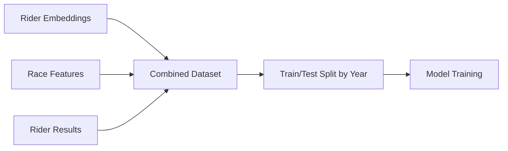

# Embedding Performance Prediction System

## Overview

The embedding performance prediction system is a comprehensive machine learning framework that predicts cyclist UCI points using rider embeddings, race characteristics, and historical performance data. The system combines three types of features to create accurate performance predictions for different race types.

## System Architecture

### Core Components

1. **Data Preparation** (`data_preparation.py`) - Combines multiple data sources
2. **Model Training** (`embedding_model.py`) - Two-stage LightGBM models
3. **Reporting** (`model_reporter.py`) - Comprehensive performance analysis
4. **Training Script** (`train_embedding_models.py`) - CLI interface for model training

### Three-Feature Approach

The system uses three complementary types of features:

#### 🏁 **Race Features** (10-15 features per race type)
- **Source**: `race_features_N` database tables (percentile-based)
- **Examples**: `total_finishers`, `abandon_ratio`, `winning_time`, `20th_percentile_gap`
- **Purpose**: Capture race difficulty and characteristics
- **Dynamic Loading**: Automatically loads the correct percentile table for each race type

#### 📊 **Embedding Features** (Optimized: 5-7 features | Full: ~37 features per race type)  
- **Source**: Pre-computed rider embeddings - OPTIMIZED or FULL versions available
  - **Optimized**: `race_type_optimized_data/` (feature-selected, 5-7 features)
  - **Full**: `race_type_full_embeddings/` (all features, ~37 features per percentile)
- **Examples**: 
  - **Optimized**: `corr_total_race_duration`, `corr_abandon_ratio`, `n_races`
  - **Full**: All race feature correlations (no feature selection applied)
- **Purpose**: Capture rider's historical correlation patterns with race characteristics
- **Race-Type Specific**: Different embeddings for gc, stage, one_day, stage_one_day, all
- **Flexible Percentiles**: Full embeddings support any percentile (30th-100th)

#### 📋 **Database Features** (17-18 features)
- **Source**: `rider_results` table with historical performance data
- **Examples**: `prior_gc_points_proportional`, `tour_level_encoded`, `rider_age`
- **Purpose**: Rider's historical performance and demographic information
- **Cross-Race-Type**: Includes performance history from all race types

## Race Type Models

The system trains separate models for each race type using either **optimized** or **full** embeddings:

### Optimized Embeddings (Default)
- **`gc`**: General Classification races (race_features_90, 7 selected features)
- **`stage`**: Individual stages (race_features_30, 6 selected features) 
- **`one_day`**: One-day races (race_features_90, 10 selected features)
- **`stage_one_day`**: Combined stage + one-day (race_features_90, 5 selected features)
- **`all`**: All race types combined (race_features_90, 5 selected features)

### Full Embeddings (Research/Baseline)
- **All race types**: Use ALL ~37 features from any percentile (race_features_30 through race_features_100)
- **Purpose**: Baseline comparison to test if feature selection actually improves performance
- **Flexibility**: Experiment with different percentiles to find optimal feature source

## Model Architecture

### Two-Stage Approach

Each model uses a two-stage LightGBM architecture to handle zero-inflated UCI points:

1. **Stage 1: Classification** 
   - Predicts probability of earning non-zero points
   - Handles the 65-85% of results with zero points
   - Uses `binary` objective with `is_unbalance=True`

2. **Stage 2: Regression**
   - Predicts actual point values for non-zero cases
   - Trained only on samples with points > 0
   - Uses regularization to prevent overfitting

3. **Final Prediction**
   - `final_pred = prob > 0.5 ? regressor_pred : 0`
   - Non-negative predictions enforced

### Performance Metrics

The system tracks comprehensive metrics:
- **Overall**: RMSE, MAE on all samples
- **Non-zero**: RMSE, MAE, R² on point-scoring samples  
- **Classification**: AUC, accuracy for zero vs non-zero prediction
- **Feature Importance**: Separate tracking for classifier and regressor stages

## Data Flow

### Training Data Preparation



1. **Load Embeddings**: Race-type specific embeddings with correlation features
2. **Load Race Features**: Dynamic loading based on embedding config percentile
3. **Load Rider Results**: Historical performance and competition metadata
4. **Merge Data**: Join on `rider_result_id` and `competition_id`
5. **Feature Engineering**: Encode tour levels, exclude outcome variables
6. **Temporal Split**: Train on years < X, test on year X

### Prediction Pipeline

For new predictions, the system requires:

```python
{
    "rider_id": 1234,
    "competition_id": 5678,
    "embedding_features": {...},  # From rider embedding system
    "race_features": {...},       # From race_features table
    "historical_features": {...}  # From rider_results table
}
```

## Usage Examples

### Basic Model Training (Optimized Embeddings)

```bash
# Train all race types for 2023 using optimized embeddings (default)
python train_embedding_models.py --year 2023

# Train specific race type with model saving
python train_embedding_models.py --year 2023 --race-type gc --save-models

# All optimized models use pre-selected features from feature selection pipeline
```

### Full Embeddings Training (Research/Baseline)

```bash
# Train all race types using FULL embeddings with 90th percentile
python train_embedding_models.py --year 2023 --use-full-embeddings --percentile race_features_90

# Train specific race type with full embeddings
python train_embedding_models.py --year 2023 --race-type gc --use-full-embeddings --percentile race_features_90 --save-models

# Experiment with different percentiles
python train_embedding_models.py --year 2023 --race-type gc --use-full-embeddings --percentile race_features_70
python train_embedding_models.py --year 2023 --race-type gc --use-full-embeddings --percentile race_features_100

# Compare multiple percentiles for research
for percentile in race_features_70 race_features_80 race_features_90; do
    python train_embedding_models.py --year 2023 --race-type gc --use-full-embeddings --percentile $percentile --save-models
done
```

### Command Line Options

```bash
# Required
--year YEAR                    # Year to use for testing (trains on prior years)

# Optional - Embedding Type
--use-full-embeddings          # Use full embeddings instead of optimized (requires --percentile)
--percentile PERCENTILE        # For full embeddings: race_features_30, race_features_40, ..., race_features_100

# Optional - Model Configuration  
--race-type {gc,stage,one_day,stage_one_day,all}  # Train specific race type (default: all)
--save-models                  # Save trained models to disk
--model-dir DIR                # Directory to save models (default: models)
--report-dir DIR               # Directory to save reports (default: reports)

# Optional - Data Paths
--db-path PATH                 # Path to cycling database (default: database/database/cycling_races.db)
--embedding-path PATH          # Path to optimized embeddings (default: race_type_optimized_data)
--full-embeddings-path PATH    # Path to full embeddings (default: race_type_full_embeddings)
```

### Programmatic Usage

#### Using Optimized Embeddings (Default)
```python
from data_preparation import EmbeddingDataPreparation
from embedding_model import EmbeddingPerformanceModel

# Prepare data with optimized embeddings (default)
prep = EmbeddingDataPreparation("database/database/cycling_races.db")
gc_data = prep.prepare_race_type_data('gc')
train_df, test_df = prep.split_by_year(gc_data, test_year=2023)

# Train model
model = EmbeddingPerformanceModel(race_type='gc')
training_info = model.train(train_df=train_df, valid_df=test_df)

# Make predictions
predictions = model.predict(test_features)
probabilities = model.predict_proba_nonzero(test_features)

# Analyze results
importance = model.get_feature_importance(stage='both', n_features=20)
```

#### Using Full Embeddings for Research
```python
from data_preparation import EmbeddingDataPreparation
from embedding_model import EmbeddingPerformanceModel

# Prepare data with FULL embeddings
prep = EmbeddingDataPreparation(
    db_path="database/database/cycling_races.db",
    use_full_embeddings=True,
    full_embeddings_path="race_type_full_embeddings"
)

# Load specific percentile data
gc_data = prep.prepare_race_type_data('gc', percentile='race_features_90')
train_df, test_df = prep.split_by_year(gc_data, test_year=2023)

print(f"Full embeddings data shape: {gc_data.shape}")
feature_cols = [col for col in gc_data.columns if col not in ['rider_result_id', 'year', 'competition_race_type', 'uci_points_proportional', 'competition_id', 'rider_id']]
print(f"Total features: {len(feature_cols)}")

# Train model (same API)
model = EmbeddingPerformanceModel(race_type='gc')
training_info = model.train(train_df=train_df, valid_df=test_df)
```

#### Comparing Optimized vs Full Embeddings
```python
# Helper function to train and compare models
def compare_embedding_types(race_type='gc', test_year=2023):
    results = {}
    
    # Train with optimized embeddings
    prep_opt = EmbeddingDataPreparation("database/database/cycling_races.db")
    data_opt = prep_opt.prepare_race_type_data(race_type)
    train_opt, test_opt = prep_opt.split_by_year(data_opt, test_year)
    
    model_opt = EmbeddingPerformanceModel(race_type=race_type)
    results['optimized'] = model_opt.train(train_opt, test_opt)
    
    # Train with full embeddings
    prep_full = EmbeddingDataPreparation(
        "database/database/cycling_races.db", 
        use_full_embeddings=True
    )
    data_full = prep_full.prepare_race_type_data(race_type, percentile='race_features_90')
    train_full, test_full = prep_full.split_by_year(data_full, test_year)
    
    model_full = EmbeddingPerformanceModel(race_type=race_type)
    results['full'] = model_full.train(train_full, test_full)
    
    # Compare performance
    print(f"Optimized AUC: {results['optimized']['performance_metrics']['auc_classification']:.3f}")
    print(f"Full AUC: {results['full']['performance_metrics']['auc_classification']:.3f}")
    
    return results, model_opt, model_full

# Run comparison
results, opt_model, full_model = compare_embedding_types('gc', 2023)
```

### Loading Saved Models

```python
# Load optimized embedding model (default naming)
model_opt = EmbeddingPerformanceModel(race_type='gc')
model_opt.load("models/gc_model_2023")

# Load full embedding model (includes percentile in name)
model_full = EmbeddingPerformanceModel(race_type='gc')
model_full.load("models/gc_model_2023_full_90")

# Use for predictions
predictions_opt = model_opt.predict(new_features)
predictions_full = model_full.predict(new_features)

# Compare predictions
import pandas as pd
comparison = pd.DataFrame({
    'optimized': predictions_opt,
    'full': predictions_full,
    'difference': predictions_opt - predictions_full
})
print(f"Mean prediction difference: {comparison['difference'].mean():.2f}")
```

### Model Naming Convention

Saved models follow these naming patterns:
- **Optimized**: `{race_type}_model_{year}` (e.g., `gc_model_2023`)
- **Full**: `{race_type}_model_{year}_full_{percentile}` (e.g., `gc_model_2023_full_90`)

This makes it easy to identify which embedding type and configuration was used.

## Integration Points

### For Frontend Development

The system provides JSON reports with:
- Model performance metrics
- Feature importance rankings by type (embedding/race/database)
- Training/test dataset statistics
- Model metadata and configuration

```python
# Access training report
with open("reports/gc_model_report_2023.json") as f:
    report = json.load(f)
    
print(f"Model AUC: {report['model_performance']['auc_classification']}")
print(f"Top features: {report['feature_importance']['classifier']['all_features'][:5]}")
```

### For Prediction Pipelines

Required data sources for live predictions:

1. **Rider Embeddings**: From `rider_embeddings` system
   - Load appropriate race type embeddings
   - Extract correlation features for the rider

2. **Race Features**: From `race_features_N` tables
   - Use same percentile as training (from model metadata)
   - Include competition-specific race characteristics

3. **Historical Features**: From `rider_results` table
   - Prior performance across all race types
   - Rider demographics (age, tour level)

### For Model Monitoring

Track model performance over time:
- Prediction accuracy by race type
- Feature importance drift
- Data quality metrics (missing features, outliers)
- Temporal performance (recent vs historical accuracy)

## File Structure

```
embedding_performance_prediction/
├── README.md                    # This overview
├── data_preparation.py          # Data loading and merging
├── data_preparation.md          # API documentation
├── embedding_model.py           # Two-stage model implementation  
├── embedding_model.md           # Model documentation
├── model_reporter.py            # Report generation
├── model_reporter.md            # Reporting documentation
├── train_embedding_models.py    # CLI training script
├── train_embedding_models.md    # Training script documentation
├── models/                      # Saved model files
├── reports/                     # Training reports and analysis
└── __init__.py                 # Package initialization
```

## Key Design Decisions

### Data Exclusions
- **Outcome Variables**: `place`, `time_gap`, `percentile` excluded to prevent data leakage
- **Metadata**: IDs, timestamps, and administrative fields excluded from features
- **Historical Actuals**: `*_actual` columns excluded to avoid using future information

### Feature Engineering
- **Tour Level Encoding**: d1=0, pro=1, wt=2 for ordinal relationship
- **Cross-Race-Type Features**: All race type histories included regardless of model type
- **Missing Value Handling**: Filled with 0 for consistency

### Model Design
- **Separate Models**: Each race type gets its own optimized model
- **Temporal Validation**: Always test on future years to simulate real-world usage
- **Zero-Inflation Handling**: Two-stage approach optimized for UCI points distribution

## Performance Benchmarks

### Optimized Embeddings (Feature-Selected)
Typical model performance with optimized embeddings:
- **Classification AUC**: 0.67-0.84 across race types
- **Overall RMSE**: 90-100 UCI points
- **Zero Prediction Accuracy**: 69-76%
- **Non-zero R²**: 0.30-0.33
- **Feature Count**: 5-7 selected features per race type

### Full Embeddings (All Features)
Expected performance characteristics with full embeddings:
- **Feature Count**: ~37 features per percentile
- **Model Complexity**: Higher (more parameters)
- **Training Time**: Longer due to more features
- **Potential Overfitting**: Higher risk with more features
- **Research Value**: Establishes baseline for comparison

### Research Questions
Key questions to explore with full vs optimized embeddings:
1. **Does feature selection improve generalization?**
2. **Which percentiles work best with all features?**
3. **Is there a trade-off between complexity and performance?**
4. **Do different race types benefit differently from feature selection?**

## Experimental Workflows

### Research Pipeline Example
```bash
# Compare feature selection effectiveness across race types
for race_type in gc stage one_day stage_one_day all; do
    echo "Training $race_type with optimized embeddings..."
    python train_embedding_models.py --year 2023 --race-type $race_type --save-models
    
    echo "Training $race_type with full embeddings..."
    python train_embedding_models.py --year 2023 --race-type $race_type --use-full-embeddings --percentile race_features_90 --save-models
done

# Analyze results
python -c "
import json
import glob

# Load all reports and compare
for race_type in ['gc', 'stage', 'one_day', 'stage_one_day', 'all']:
    try:
        with open(f'reports/{race_type}_model_report_2023.json') as f:
            opt_report = json.load(f)
        print(f'{race_type} Optimized AUC: {opt_report[\"model_performance\"][\"auc_classification\"]:.3f}')
    except FileNotFoundError:
        print(f'{race_type} optimized report not found')
"
```

### Percentile Comparison Study
```bash
# Test which percentile works best with full embeddings
race_type="gc"
for percentile in race_features_30 race_features_50 race_features_70 race_features_90; do
    echo "Testing $race_type with $percentile..."
    python train_embedding_models.py --year 2023 --race-type $race_type --use-full-embeddings --percentile $percentile --save-models
done
```

## Future Enhancements

Potential areas for improvement:
1. **Hybrid Approaches**: Combine optimized and full embeddings
2. **Automated Feature Selection**: Dynamic feature selection during training
3. **Ensemble Methods**: Combine optimized and full embedding models
4. **Real-time Features**: Weather, route profile, competition strength  
5. **Deep Learning**: Neural networks for complex feature interactions
6. **Automated Retraining**: Pipeline for model updates with new data
7. **Prediction Intervals**: Uncertainty quantification for predictions
8. **Cross-Validation**: More robust evaluation across multiple years