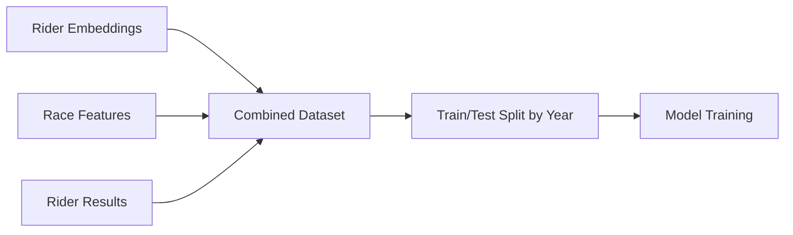

# Embedding Performance Prediction System

## Overview

The embedding performance prediction system is a comprehensive machine learning framework that predicts cyclist UCI points using rider embeddings, race characteristics, and historical performance data. The system combines three types of features to create accurate performance predictions for different race types.

## System Architecture

### Core Components

1. **Data Preparation** (`data_preparation.py`) - Combines multiple data sources
2. **Model Training** (`embedding_model.py`) - Two-stage LightGBM models
3. **Reporting** (`model_reporter.py`) - Comprehensive performance analysis
4. **Training Script** (`train_embedding_models.py`) - CLI interface for model training

### Three-Feature Approach

The system uses three complementary types of features:

#### 🏁 **Race Features** (10-15 features per race type)
- **Source**: `race_features_N` database tables (percentile-based)
- **Examples**: `total_finishers`, `abandon_ratio`, `winning_time`, `20th_percentile_gap`
- **Purpose**: Capture race difficulty and characteristics
- **Dynamic Loading**: Automatically loads the correct percentile table for each race type

#### 📊 **Embedding Features** (8-11 features per race type)  
- **Source**: Pre-computed rider embeddings from `race_type_optimized_data/`
- **Examples**: `corr_total_race_duration`, `corr_abandon_ratio`, `n_races`
- **Purpose**: Capture rider's historical correlation patterns with race characteristics
- **Race-Type Specific**: Different embeddings for gc, stage, one_day, stage_one_day, all

#### 📋 **Database Features** (17-18 features)
- **Source**: `rider_results` table with historical performance data
- **Examples**: `prior_gc_points_proportional`, `tour_level_encoded`, `rider_age`
- **Purpose**: Rider's historical performance and demographic information
- **Cross-Race-Type**: Includes performance history from all race types

## Race Type Models

The system trains separate models for each race type:

- **`gc`**: General Classification races (race_features_90, 7 race features)
- **`stage`**: Individual stages (race_features_30, 6 race features) 
- **`one_day`**: One-day races (race_features_90, 10 race features)
- **`stage_one_day`**: Combined stage + one-day (race_features_90, 5 race features)
- **`all`**: All race types combined (race_features_90, 5 race features)

## Model Architecture

### Two-Stage Approach

Each model uses a two-stage LightGBM architecture to handle zero-inflated UCI points:

1. **Stage 1: Classification** 
   - Predicts probability of earning non-zero points
   - Handles the 65-85% of results with zero points
   - Uses `binary` objective with `is_unbalance=True`

2. **Stage 2: Regression**
   - Predicts actual point values for non-zero cases
   - Trained only on samples with points > 0
   - Uses regularization to prevent overfitting

3. **Final Prediction**
   - `final_pred = prob > 0.5 ? regressor_pred : 0`
   - Non-negative predictions enforced

### Performance Metrics

The system tracks comprehensive metrics:
- **Overall**: RMSE, MAE on all samples
- **Non-zero**: RMSE, MAE, R² on point-scoring samples  
- **Classification**: AUC, accuracy for zero vs non-zero prediction
- **Feature Importance**: Separate tracking for classifier and regressor stages

## Data Flow

### Training Data Preparation



1. **Load Embeddings**: Race-type specific embeddings with correlation features
2. **Load Race Features**: Dynamic loading based on embedding config percentile
3. **Load Rider Results**: Historical performance and competition metadata
4. **Merge Data**: Join on `rider_result_id` and `competition_id`
5. **Feature Engineering**: Encode tour levels, exclude outcome variables
6. **Temporal Split**: Train on years < X, test on year X

### Prediction Pipeline

For new predictions, the system requires:

```python
{
    "rider_id": 1234,
    "competition_id": 5678,
    "embedding_features": {...},  # From rider embedding system
    "race_features": {...},       # From race_features table
    "historical_features": {...}  # From rider_results table
}
```

## Usage Examples

### Basic Model Training

```bash
# Train all race types for 2023
python train_embedding_models.py --year 2023

# Train specific race type with model saving
python train_embedding_models.py --year 2023 --race-type gc --save-models
```

### Programmatic Usage

```python
from data_preparation import EmbeddingDataPreparation
from embedding_model import EmbeddingPerformanceModel

# Prepare data
prep = EmbeddingDataPreparation("database/database/cycling_races.db")
gc_data = prep.prepare_race_type_data('gc')
train_df, test_df = prep.split_by_year(gc_data, test_year=2023)

# Train model
model = EmbeddingPerformanceModel(race_type='gc')
training_info = model.train(train_df=train_df, valid_df=test_df)

# Make predictions
predictions = model.predict(test_features)
probabilities = model.predict_proba_nonzero(test_features)

# Analyze results
importance = model.get_feature_importance(stage='both', n_features=20)
```

### Loading Saved Models

```python
# Load pre-trained model
model = EmbeddingPerformanceModel(race_type='gc')
model.load("models/gc_model_2023")

# Use for predictions
predictions = model.predict(new_features)
```

## Integration Points

### For Frontend Development

The system provides JSON reports with:
- Model performance metrics
- Feature importance rankings by type (embedding/race/database)
- Training/test dataset statistics
- Model metadata and configuration

```python
# Access training report
with open("reports/gc_model_report_2023.json") as f:
    report = json.load(f)
    
print(f"Model AUC: {report['model_performance']['auc_classification']}")
print(f"Top features: {report['feature_importance']['classifier']['all_features'][:5]}")
```

### For Prediction Pipelines

Required data sources for live predictions:

1. **Rider Embeddings**: From `rider_embeddings` system
   - Load appropriate race type embeddings
   - Extract correlation features for the rider

2. **Race Features**: From `race_features_N` tables
   - Use same percentile as training (from model metadata)
   - Include competition-specific race characteristics

3. **Historical Features**: From `rider_results` table
   - Prior performance across all race types
   - Rider demographics (age, tour level)

### For Model Monitoring

Track model performance over time:
- Prediction accuracy by race type
- Feature importance drift
- Data quality metrics (missing features, outliers)
- Temporal performance (recent vs historical accuracy)

## File Structure

```
embedding_performance_prediction/
├── README.md                    # This overview
├── data_preparation.py          # Data loading and merging
├── data_preparation.md          # API documentation
├── embedding_model.py           # Two-stage model implementation  
├── embedding_model.md           # Model documentation
├── model_reporter.py            # Report generation
├── model_reporter.md            # Reporting documentation
├── train_embedding_models.py    # CLI training script
├── train_embedding_models.md    # Training script documentation
├── models/                      # Saved model files
├── reports/                     # Training reports and analysis
└── __init__.py                 # Package initialization
```

## Key Design Decisions

### Data Exclusions
- **Outcome Variables**: `place`, `time_gap`, `percentile` excluded to prevent data leakage
- **Metadata**: IDs, timestamps, and administrative fields excluded from features
- **Historical Actuals**: `*_actual` columns excluded to avoid using future information

### Feature Engineering
- **Tour Level Encoding**: d1=0, pro=1, wt=2 for ordinal relationship
- **Cross-Race-Type Features**: All race type histories included regardless of model type
- **Missing Value Handling**: Filled with 0 for consistency

### Model Design
- **Separate Models**: Each race type gets its own optimized model
- **Temporal Validation**: Always test on future years to simulate real-world usage
- **Zero-Inflation Handling**: Two-stage approach optimized for UCI points distribution

## Performance Benchmarks

Typical model performance (without percentile feature):
- **Classification AUC**: 0.67-0.84 across race types
- **Overall RMSE**: 90-100 UCI points
- **Zero Prediction Accuracy**: 69-76%
- **Non-zero R²**: 0.30-0.33

## Future Enhancements

Potential areas for improvement:
1. **Real-time Features**: Weather, route profile, competition strength
2. **Ensemble Methods**: Combine multiple race type models
3. **Deep Learning**: Neural networks for complex feature interactions
4. **Automated Retraining**: Pipeline for model updates with new data
5. **Prediction Intervals**: Uncertainty quantification for predictions